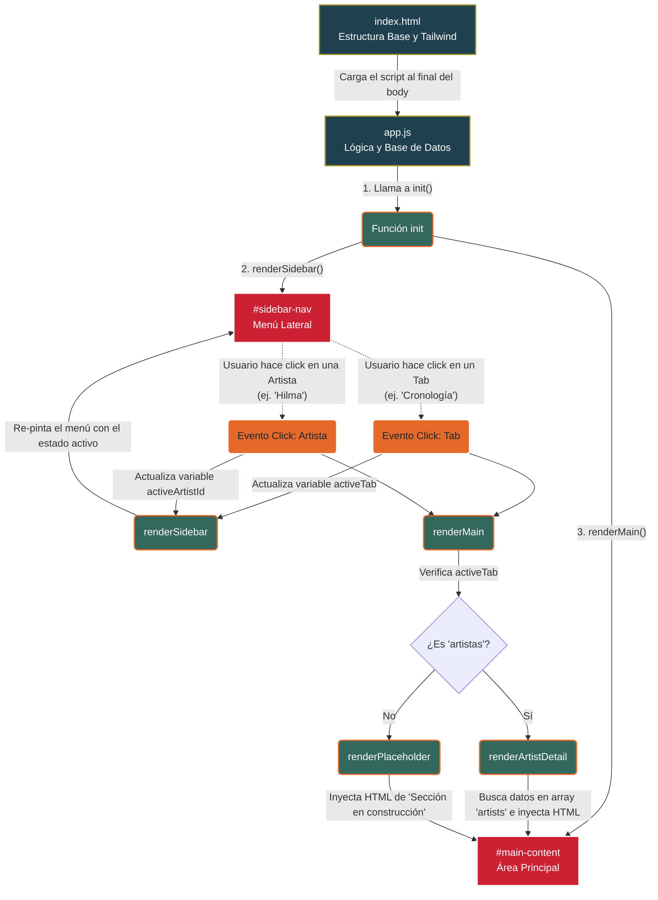

# Arquitectura y Flujo del Código

Este diagrama explica cómo funciona la aplicación por debajo (la relación entre `index.html` y `app.js`), de forma visual.

## Resumen del Comportamiento

1. **Datos Desacoplados:** Toda la información (biografías, nombres de obras, etc.) vive en un arreglo `artists` al principio de `app.js`. El HTML solo contiene el contenedor vacío.
2. **Estado (State):** Hay dos variables cruciales: `activeTab` (sabe qué pestaña principal estás viendo) y `activeArtistId` (sabe qué artista estás viendo).
3. **Re-renderizado:** Cada vez que haces clic en un elemento del menú, la aplicación no recarga la página. En cambio, actualiza las variables de estado y vuelve a "dibujar" (re-renderizar) los menús y el contenido principal inyectando el código HTML internamente con JavaScript.
